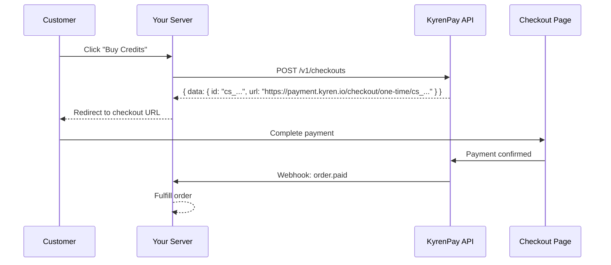

This guide explains one-time hosted Checkout integration using a Node.js backend. The examples require your application's login and database adapters before they can run. The same flow applies to other languages.

Before accepting payments, complete the [Quickstart prerequisites](/quickstart#prerequisites) and configure your public HTTPS Webhook URL and its separate Secret in the merchant dashboard. An `order.paid` event is not queued when the Webhook is unconfigured; configuring it after a payment does not automatically replay that payment.

## Choose your setup path

- Use the dashboard guide if you want to create products and review orders manually first.
- Use the API guide if your application should create checkout sessions from your server.

Related pages:

- [Products dashboard](/dashboard/products)
- [Orders dashboard](/dashboard/orders)
- [Quickstart](/quickstart)
- [Webhook overview](/webhooks/overview)

## Overview



## 1. Set Up Your Server

Install the required dependencies:

```bash
npm init -y
npm install express axios
```

Create your server file. Implement `app-adapters.js` using your application's authentication and database:

- `requireUser` rejects unauthenticated requests and supplies `req.user` from a verified login, never from client-supplied user IDs. Apply your application's CSRF protection to cookie-authenticated purchase requests.
- `checkoutStore.withLockedOrder(userId, productId, callback)` creates or locks the user's current pending business order, with authorization and a database lock or durable reservation across processes. Persist its expected product, price, currency and credit entitlement from your server's catalog.
- `markCreationPending` durably records creation in progress **before** calling KyrenPay. `attachSession` stores the Session ID, URL, amount, currency and expiry, verifies them against the order, and clears that marker. Keep the marker on timeouts or failed local saves; releasing a lock must not roll it back. Do not automatically create another Session for an uncertain request: the current API has no Checkout creation idempotency key.
- `webhookInbox.insertIfAbsent` durably inserts a pending event with a unique event ID. Existing events are acknowledged without resetting their processing state. A worker must claim pending events and retry failures until handled or escalated.
- `fulfillPaidOrderIdempotently` checks the business order association, product, base amount and currency using decimal arithmetic. In one database transaction, uniquely record the KyrenPay order ID, mark the business order fulfilled and credit its recorded user and entitlement. Reject missing or mismatched associations. Apply it to both Webhooks and reconciliation.

Register JSON parsing only on normal routes, as shown below. Never register a global `express.json()` before the raw Webhook route.

```javascript
// server.js
const express = require('express');
const crypto = require('crypto');
const axios = require('axios');
const { requireUser, checkoutStore, webhookInbox, fulfillPaidOrderIdempotently } = require('./app-adapters');

const app = express();

const KYREN_API_KEY = process.env.KYREN_API_KEY;
const KYREN_WEBHOOK_SECRET = process.env.KYREN_WEBHOOK_SECRET;
const KYREN_BASE_URL = process.env.KYREN_BASE_URL || 'https://api.kyrenpay.com';
const KYREN_PRODUCT_ID = process.env.KYREN_PRODUCT_ID;

if (!KYREN_API_KEY || !KYREN_WEBHOOK_SECRET || !KYREN_PRODUCT_ID) {
  throw new Error('Configure API key, Webhook secret and product ID');
}
```

## 2. Create a Product (One-Time Setup)

Create a fixed-price product once via the API or dashboard and set its returned `data.id` as `KYREN_PRODUCT_ID`. Checkout takes its amount and currency from that product; it does not accept per-session price, quantity or currency overrides. Product metadata is not automatically merged into Checkout metadata. Keep the expected entitlement in your business order.

Create the product before starting `server.js`, because startup requires its ID. For example, with `KYREN_API_KEY` already set in your shell:

```bash
curl --fail-with-body -X POST "${KYREN_BASE_URL:-https://api.kyrenpay.com}/v1/products" \
  -H "Content-Type: application/json" \
  -H "x-api-key: ${KYREN_API_KEY}" \
  -d '{"name":"1000 AI Credits","price":"9.99","currency":"USD"}'
```

Use the returned `data.id` in the startup command. The function below is an alternative server-side request example; defining it does not execute it. Set `KYREN_BASE_URL` to the environment paired with your credentials when using an issued staging or local environment; changing credentials alone does not change the target API.

```javascript
async function createProduct() {
  const response = await axios.post(`${KYREN_BASE_URL}/v1/products`, {
    name: '1000 AI Credits',
    description: 'Top up 1000 credits for AI API usage',
    price: '9.99',
    currency: 'USD',
    metadata: { credits: '1000' }
  }, {
    headers: { 'x-api-key': KYREN_API_KEY }
  });

  console.log('Product created:', response.data.data.id);
  return response.data.data;
}
```

## 3. Create Checkout Endpoint

Add an endpoint that creates a checkout session when the customer clicks "Buy":

```javascript
app.post('/api/buy-credits', requireUser, express.json(), async (req, res) => {
  try {
    const checkout = await checkoutStore.withLockedOrder(req.user.id, KYREN_PRODUCT_ID, async (order) => {
      const headers = { 'x-api-key': KYREN_API_KEY };
      if (order.checkoutId) {
        const response = await axios.get(`${KYREN_BASE_URL}/v1/checkouts/${order.checkoutId}`, { headers, timeout: 10000 });
        const existing = response.data.data;
        if (existing.status === 'OPEN' && existing.expiresAt > Date.now()) return existing;
        throw new Error('Reconcile the previous checkout before starting another purchase');
      }
      if (order.creationPending) throw new Error('Checkout creation requires reconciliation');
      await checkoutStore.markCreationPending(order.id);
      const response = await axios.post(`${KYREN_BASE_URL}/v1/checkouts`, {
        productId: KYREN_PRODUCT_ID,
        successUrl: 'https://yoursite.com/payment/success',
        cancelUrl: 'https://yoursite.com/payment/cancel',
        customerEmail: req.user.email,
        metadata: { businessOrderId: order.id, userId: String(req.user.id) }
      }, { headers, timeout: 10000 });
      const session = response.data.data;
      if (response.data.code !== 0 || !session?.id || !session?.url) throw new Error('Invalid checkout response');
      await checkoutStore.attachSession(order.id, session);
      return session;
    });
    res.json({ checkoutId: checkout.id, checkoutUrl: checkout.url });
  } catch (error) {
    res.status(503).json({ error: 'Checkout unavailable; reconcile before retrying' });
  }
});
```

## 4. Handle the Frontend Redirect

On your frontend, redirect the customer to the checkout page:

```html
<button id="buy-btn">Buy 1000 Credits - $9.99</button>

<script>
document.getElementById('buy-btn').addEventListener('click', async () => {
  const response = await fetch('/api/buy-credits', {
    method: 'POST',
    headers: { 'Content-Type': 'application/json' },
    credentials: 'same-origin',
    body: JSON.stringify({})
  });

  if (!response.ok) throw new Error('Checkout unavailable');
  const { checkoutUrl } = await response.json();
  window.location.href = checkoutUrl;
});
</script>
```

## 5. Handle Webhooks

Add a webhook endpoint to receive payment notifications:

```javascript
function verifySignature(payload, signature, timestamp) {
  if (typeof signature !== 'string' || !/^sha256=[0-9a-f]{64}$/.test(signature)) return false;
  if (typeof timestamp !== 'string' || !/^\d+$/.test(timestamp)) return false;
  const sentAt = Number(timestamp);
  if (!Number.isSafeInteger(sentAt) || Math.abs(Date.now() - sentAt) > 300000) return false;
  const data = `${timestamp}.${payload}`;
  const expected = 'sha256=' + crypto
    .createHmac('sha256', KYREN_WEBHOOK_SECRET)
    .update(data)
    .digest('hex');

  return crypto.timingSafeEqual(
    Buffer.from(expected),
    Buffer.from(signature)
  );
}

app.post('/webhooks/kyren',
  express.raw({ type: 'application/json' }),
  async (req, res) => {
    const signature = req.headers['x-kyren-signature'];
    const timestamp = req.headers['x-kyren-timestamp'];
    if (!Buffer.isBuffer(req.body)) return res.status(400).send('Raw JSON body required');
    const payload = req.body.toString('utf8');

    if (!verifySignature(payload, signature, timestamp)) {
      return res.status(400).send('Invalid signature');
    }

    let event;
    try { event = JSON.parse(payload); } catch { return res.status(400).send('Invalid JSON'); }
    if (!event || typeof event.id !== 'string' || !event.id || typeof event.type !== 'string' || !event.data) {
      return res.status(400).send('Invalid event');
    }
    try {
      await webhookInbox.insertIfAbsent(event.id, event);
    } catch {
      return res.status(503).send('Retry later');
    }
    res.status(200).send('OK');
  }
);
```

## 6. Process Notifications and Reconcile Payments

Run the following functions from your durable inbox worker and a scheduled reconciliation job, respectively. Mark an inbox event processed only after `processWebhook` succeeds; a failure must remain retryable.

```javascript
async function processWebhook(event) {
  if (event.type !== 'order.paid') return;
  const data = event.data;
  await fulfillPaidOrderIdempotently({
    businessOrderId: data.metadata?.businessOrderId,
    kyrenOrderId: data.order_id,
    productId: data.product_id,
    amount: data.amount,
    currency: data.currency
  });
}

async function reconcilePayment(order) {
  const headers = { 'x-api-key': KYREN_API_KEY };
  const sessionResponse = await axios.get(`${KYREN_BASE_URL}/v1/checkouts/${order.checkoutId}`, { headers, timeout: 10000 });
  const session = sessionResponse.data.data;
  if (session.status !== 'COMPLETE' || !session.orderId) return;
  const paymentResponse = await axios.get(`${KYREN_BASE_URL}/v1/orders/${session.orderId}`, { headers, timeout: 10000 });
  const payment = paymentResponse.data.data;
  if (payment.status !== 'PAID') return;
  if (payment.checkoutSessionId !== order.checkoutId || payment.metadata?.businessOrderId !== order.id) {
    throw new Error('Payment association mismatch');
  }
  await fulfillPaidOrderIdempotently({
    businessOrderId: order.id,
    kyrenOrderId: payment.id,
    productId: payment.productId,
    amount: payment.baseAmount,
    currency: payment.currency
  });
}
```

Load reconciliation orders from your own database; do not accept arbitrary order IDs from the browser. Handle refunds separately using [Webhook events](/webhooks/events). Both payment paths must use the same fulfillment transaction so a late Webhook cannot credit an already reconciled order again.

Checkout expires after 24 hours and uses `OPEN`, `COMPLETE`, `EXPIRED`. Its successful KyrenPay `orderId` is available through the authenticated Session query; it is not returned when creating the Session. An expired or canceled browser flow is not proof that an existing payment attempt failed. Reconcile before offering a replacement purchase. Show pending status on `successUrl` until your backend confirms payment; never credit from a browser redirect. Use the exact returned `data.url`, without constructing the hosted path yourself.

## 7. Start the Server

```javascript
app.listen(3000, () => {
  console.log('Server running on http://localhost:3000');
});
```

Run your server:

```bash
KYREN_API_KEY=kyren_live_xxx KYREN_WEBHOOK_SECRET=whsec_xxx KYREN_PRODUCT_ID=prod_xxx node server.js
```

## 8. Test the Flow

1. If KyrenPay has issued staging credentials or enabled a test-capable gateway for your merchant account, run the flow with those credentials and the payment scenarios KyrenPay provides.
2. If you only have live credentials, verify the flow with a low-risk real payment in production.
3. Confirm your customer is redirected to the KyrenPay checkout page.
4. Confirm your server receives the payment Webhook and that your fulfillment logic handles the event correctly.
   Test duplicate and concurrent notifications, unavailable inbox storage, worker restart, a Webhook racing reconciliation, and expired Sessions. Each business order must credit at most once, and failed persistence must return a non-`2xx` response.
5. If you used a real payment for verification, refund or handle it operationally according to KyrenPay support guidance if needed.

<Check>
  Your integration is ready when checkout creation, redirect handling, Webhook receipt, and fulfillment have all been verified with the credentials and gateway KyrenPay has enabled for your account.
</Check>

## Next Steps

<CardGroup cols={2}>
  <Card title="Webhook Events" icon="bell" href="/webhooks/events">
    See all available webhook event types
  </Card>
  <Card title="Code Examples" icon="code" href="/guides/code-examples">
    See integration examples in other languages
  </Card>
</CardGroup>
