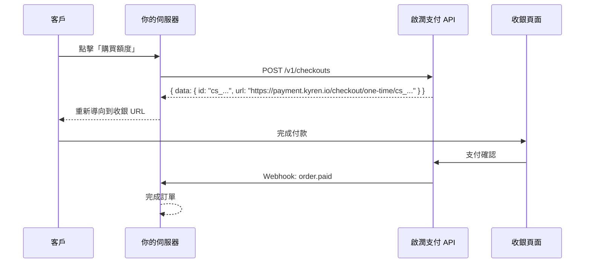

本指南以 Node.js 後端為例說明一次性原生 Checkout 接入。範例需要接入自己的登入和資料庫適配器後才能執行，相同流程適用於其他程式語言。

收款前先完成[快速開始的前提條件](/zh-Hant/quickstart#前提條件)，並在商戶控制台設定公網 HTTPS Webhook URL 和獨立的 Webhook Secret。未設定時後端不會建立普通 `order.paid` 通知事件，付款後再設定不會自動補發該付款通知。

## 選擇設定路徑

- 如果你想先手動建立產品並查看訂單，請使用控制台指南。
- 如果你的應用需要從服務端建立 Checkout Session，請使用 API 指南。

相關頁面：

- [產品控制台](/zh-Hant/dashboard/products)
- [訂單控制台](/zh-Hant/dashboard/orders)
- [快速開始](/zh-Hant/quickstart)
- [Webhook 總覽](/zh-Hant/webhooks/overview)

## 概覽



## 1. 搭建伺服器

安裝所需依賴：

```bash
npm init -y
npm install express axios
```

建立伺服器檔案，並依自己的登入和資料庫實作 `app-adapters.js`：

- `requireUser` 拒絕未登入請求，透過已驗證的登入狀態設定 `req.user`，不使用客戶端傳入的使用者 ID。使用 Cookie 登入時，購買接口還需接入應用自身的 CSRF 防護。
- `checkoutStore.withLockedOrder(userId, productId, callback)` 建立或鎖定使用者目前的待付款業務訂單，並檢查歸屬。鎖或持久化占位必須跨程序有效；產品、預期金額、幣種和應發額度來自伺服器商品設定。
- `markCreationPending` 在呼叫 Kyren **之前**持久化「建立中」標記；`attachSession` 核對並儲存 Session ID、URL、金額、幣種和有效期後清除標記。逾時或本地儲存失敗時保留標記，釋放鎖不能回滾它。結果不確定時先對帳，不自動重建 Session：目前 Checkout 建立 API 沒有冪等鍵。
- `webhookInbox.insertIfAbsent` 依唯一事件 ID 持久化待處理通知；重複事件不重置處理狀態。工作程序領取待處理事件，並負責失敗重試和最終告警。
- `fulfillPaidOrderIdempotently` 校驗業務訂單關聯、產品、基礎金額和幣種，金額使用十進位計算。在同一資料庫交易中，以 Kyren 訂單 ID 唯一約束防重、標記業務訂單已履約，並向訂單記錄的使用者發放記錄的額度。關聯缺失或不匹配時拒絕入帳；Webhook 和查單補償均呼叫此函式。

JSON 解析只註冊到普通業務路由，不要在原始 Webhook 路由前註冊全域 `express.json()`。

```javascript
// server.js
const express = require('express');
const crypto = require('crypto');
const axios = require('axios');
const { requireUser, checkoutStore, webhookInbox, fulfillPaidOrderIdempotently } = require('./app-adapters');

const app = express();

const KYREN_API_KEY = process.env.KYREN_API_KEY;
const KYREN_WEBHOOK_SECRET = process.env.KYREN_WEBHOOK_SECRET;
const KYREN_BASE_URL = process.env.KYREN_BASE_URL || 'https://api.kyrenpay.com';
const KYREN_PRODUCT_ID = process.env.KYREN_PRODUCT_ID;

if (!KYREN_API_KEY || !KYREN_WEBHOOK_SECRET || !KYREN_PRODUCT_ID) {
  throw new Error('Configure API key, Webhook secret and product ID');
}
```

## 2. 建立產品（一次性操作）

固定價格產品只需透過 API 或控制台建立一次，將回傳的 `data.id` 設為 `KYREN_PRODUCT_ID`。Checkout 金額和幣種取自產品，不支援每次建立時覆蓋價格、數量或幣種。產品 metadata 不會自動合併到 Checkout metadata，應發額度應儲存在自己的業務訂單中。

在啟動 `server.js` 前先建立產品，因為啟動時必須提供產品 ID。例如，先在目前終端設定 `KYREN_API_KEY`，再執行：

```bash
curl --fail-with-body -X POST "${KYREN_BASE_URL:-https://api.kyrenpay.com}/v1/products" \
  -H "Content-Type: application/json" \
  -H "x-api-key: ${KYREN_API_KEY}" \
  -d '{"name":"1000 AI Credits","price":"9.99","currency":"USD"}'
```

將回傳的 `data.id` 填入啟動命令。下方函式是另一種伺服器請求範例，僅定義函式不會建立產品。使用已發放的 staging 或本地環境時，設定與憑證對應的 `KYREN_BASE_URL`；僅替換憑證不會切換 API 環境。

```javascript
async function createProduct() {
  const response = await axios.post(`${KYREN_BASE_URL}/v1/products`, {
    name: '1000 AI Credits',
    description: '充值 1000 個 AI API 額度',
    price: '9.99',
    currency: 'USD',
    metadata: { credits: '1000' }
  }, {
    headers: { 'x-api-key': KYREN_API_KEY }
  });

  console.log('產品已建立:', response.data.data.id);
  return response.data.data;
}
```

## 3. 建立收銀介面

新增一個在客戶點擊「購買」時建立 Checkout Session 的介面：

```javascript
app.post('/api/buy-credits', requireUser, express.json(), async (req, res) => {
  try {
    const checkout = await checkoutStore.withLockedOrder(req.user.id, KYREN_PRODUCT_ID, async (order) => {
      const headers = { 'x-api-key': KYREN_API_KEY };
      if (order.checkoutId) {
        const response = await axios.get(`${KYREN_BASE_URL}/v1/checkouts/${order.checkoutId}`, { headers, timeout: 10000 });
        const existing = response.data.data;
        if (existing.status === 'OPEN' && existing.expiresAt > Date.now()) return existing;
        throw new Error('Reconcile the previous checkout before starting another purchase');
      }
      if (order.creationPending) throw new Error('Checkout creation requires reconciliation');
      await checkoutStore.markCreationPending(order.id);
      const response = await axios.post(`${KYREN_BASE_URL}/v1/checkouts`, {
        productId: KYREN_PRODUCT_ID,
        successUrl: 'https://yoursite.com/payment/success',
        cancelUrl: 'https://yoursite.com/payment/cancel',
        customerEmail: req.user.email,
        metadata: { businessOrderId: order.id, userId: String(req.user.id) }
      }, { headers, timeout: 10000 });
      const session = response.data.data;
      if (response.data.code !== 0 || !session?.id || !session?.url) throw new Error('Invalid checkout response');
      await checkoutStore.attachSession(order.id, session);
      return session;
    });
    res.json({ checkoutId: checkout.id, checkoutUrl: checkout.url });
  } catch (error) {
    res.status(503).json({ error: 'Checkout unavailable; reconcile before retrying' });
  }
});
```

## 4. 處理前端重新導向

在前端將客戶重新導向到收銀頁面：

```html
<button id="buy-btn">購買 1000 額度 - $9.99</button>

<script>
document.getElementById('buy-btn').addEventListener('click', async () => {
  const response = await fetch('/api/buy-credits', {
    method: 'POST',
    headers: { 'Content-Type': 'application/json' },
    credentials: 'same-origin',
    body: JSON.stringify({})
  });

  if (!response.ok) throw new Error('Checkout unavailable');
  const { checkoutUrl } = await response.json();
  window.location.href = checkoutUrl;
});
</script>
```

## 5. 處理 Webhook

新增 Webhook 端點以接收支付通知：

```javascript
function verifySignature(payload, signature, timestamp) {
  if (typeof signature !== 'string' || !/^sha256=[0-9a-f]{64}$/.test(signature)) return false;
  if (typeof timestamp !== 'string' || !/^\d+$/.test(timestamp)) return false;
  const sentAt = Number(timestamp);
  if (!Number.isSafeInteger(sentAt) || Math.abs(Date.now() - sentAt) > 300000) return false;
  const data = `${timestamp}.${payload}`;
  const expected = 'sha256=' + crypto
    .createHmac('sha256', KYREN_WEBHOOK_SECRET)
    .update(data)
    .digest('hex');

  return crypto.timingSafeEqual(
    Buffer.from(expected),
    Buffer.from(signature)
  );
}

app.post('/webhooks/kyren',
  express.raw({ type: 'application/json' }),
  async (req, res) => {
    const signature = req.headers['x-kyren-signature'];
    const timestamp = req.headers['x-kyren-timestamp'];
    if (!Buffer.isBuffer(req.body)) return res.status(400).send('Raw JSON body required');
    const payload = req.body.toString('utf8');

    if (!verifySignature(payload, signature, timestamp)) {
      return res.status(400).send('Invalid signature');
    }

    let event;
    try { event = JSON.parse(payload); } catch { return res.status(400).send('Invalid JSON'); }
    if (!event || typeof event.id !== 'string' || !event.id || typeof event.type !== 'string' || !event.data) {
      return res.status(400).send('Invalid event');
    }
    try {
      await webhookInbox.insertIfAbsent(event.id, event);
    } catch {
      return res.status(503).send('Retry later');
    }
    res.status(200).send('OK');
  }
);
```

## 6. 處理通知與查單補償

分別在持久化通知工作程序和定時對帳任務中執行下列函式。只有 `processWebhook` 成功後才能將通知標記為已處理；失敗需保留重試狀態。

```javascript
async function processWebhook(event) {
  if (event.type !== 'order.paid') return;
  const data = event.data;
  await fulfillPaidOrderIdempotently({
    businessOrderId: data.metadata?.businessOrderId,
    kyrenOrderId: data.order_id,
    productId: data.product_id,
    amount: data.amount,
    currency: data.currency
  });
}

async function reconcilePayment(order) {
  const headers = { 'x-api-key': KYREN_API_KEY };
  const sessionResponse = await axios.get(`${KYREN_BASE_URL}/v1/checkouts/${order.checkoutId}`, { headers, timeout: 10000 });
  const session = sessionResponse.data.data;
  if (session.status !== 'COMPLETE' || !session.orderId) return;
  const paymentResponse = await axios.get(`${KYREN_BASE_URL}/v1/orders/${session.orderId}`, { headers, timeout: 10000 });
  const payment = paymentResponse.data.data;
  if (payment.status !== 'PAID') return;
  if (payment.checkoutSessionId !== order.checkoutId || payment.metadata?.businessOrderId !== order.id) {
    throw new Error('Payment association mismatch');
  }
  await fulfillPaidOrderIdempotently({
    businessOrderId: order.id,
    kyrenOrderId: payment.id,
    productId: payment.productId,
    amount: payment.baseAmount,
    currency: payment.currency
  });
}
```

對帳訂單從自己的資料庫讀取，不接受瀏覽器指定的任意訂單 ID。退款另依 [Webhook 事件](/zh-Hant/webhooks/events)處理。兩條付款確認路徑使用同一個入帳交易，防止補償入帳後遲到的 Webhook 再次儲值。

Checkout 有效期為 24 小時，狀態為 `OPEN`、`COMPLETE`、`EXPIRED`。成功關聯的 Kyren `orderId` 透過伺服器 Session 查詢取得，建立時不回傳。過期或瀏覽器取消不代表已存在的支付嘗試一定失敗，提供新的購買前需對帳。`successUrl` 先顯示處理中，待後端確認付款後再更新，不依瀏覽器跳轉入帳。直接使用回應的 `data.url`，不要自行拼接收銀台路徑。

## 7. 啟動伺服器

```javascript
app.listen(3000, () => {
  console.log('Server running on http://localhost:3000');
});
```

執行：

```bash
KYREN_API_KEY=kyren_live_xxx KYREN_WEBHOOK_SECRET=whsec_xxx KYREN_PRODUCT_ID=prod_xxx node server.js
```

## 8. 測試流程

1. 如果啟潤已為你的商戶帳號發放 staging 憑證，或啟用了可測試的支付閘道，請使用這些憑證和啟潤提供的支付場景執行流程。
2. 如果你只有生產憑證，請在生產環境中使用低風險的真實付款驗證流程。
3. 確認客戶會被重新導向到啟潤支付收銀頁面。
4. 確認你的伺服器能收到付款 Webhook，並且履約邏輯能正確處理該事件。
   驗證重複及並發通知、通知儲存不可用、工作程序重啟、Webhook 與查單補償並發、Session 過期等情況。每筆業務訂單最多入帳一次，持久化失敗回傳非 `2xx`。
5. 如果你使用真實付款進行驗證，請在需要時根據啟潤支援團隊的指引退款或做相應營運處理。

<Check>
  當 Checkout 建立、重新導向處理、Webhook 接收和履約邏輯都已透過啟潤為你帳號啟用的憑證和閘道驗證後，整合即可投入使用。
</Check>

## 下一步

<CardGroup cols={2}>
  <Card title="Webhook 事件" icon="bell" href="/zh-Hant/webhooks/events">
    查看所有可用的 Webhook 事件類型
  </Card>
  <Card title="程式碼範例" icon="code" href="/zh-Hant/guides/code-examples">
    查看其他語言的整合範例
  </Card>
</CardGroup>
