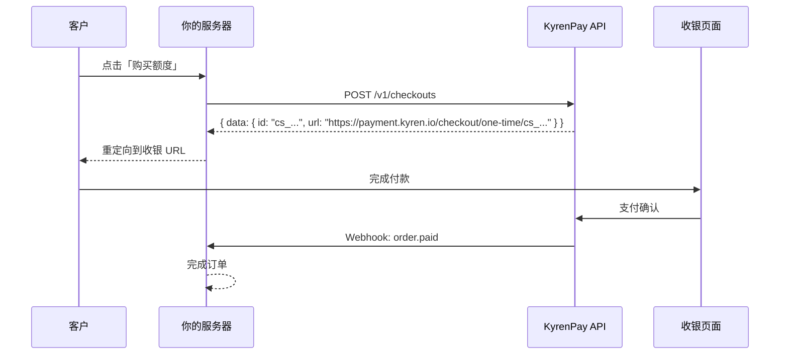

本指南以 Node.js 后端为例说明一次性原生 Checkout 接入。示例需要接入你自己的登录和数据库适配器后才能运行，相同流程适用于其他编程语言。

收款前先完成[快速开始的前提条件](/zh/quickstart#前提条件)，并在商户控制台配置公网 HTTPS Webhook URL 和独立的 Webhook Secret。未配置时后端不会创建普通 `order.paid` 通知事件，付款后再配置不会自动补发该付款通知。

## 选择设置路径

- 如果你想先手动创建产品并查看订单，请使用控制台指南。
- 如果你的应用需要从服务端创建 Checkout Session，请使用 API 指南。

相关页面：

- [产品控制台](/zh/dashboard/products)
- [订单控制台](/zh/dashboard/orders)
- [快速开始](/zh/quickstart)
- [Webhook 总览](/zh/webhooks/overview)

## 概览



## 1. 搭建服务器

安装所需依赖：

```bash
npm init -y
npm install express axios
```

创建服务器文件，并根据自己的登录和数据库实现 `app-adapters.js`：

- `requireUser` 拒绝未登录请求，通过已验证的登录态设置 `req.user`，不使用客户端传入的用户 ID。使用 Cookie 登录时，购买接口还需接入应用自身的 CSRF 防护。
- `checkoutStore.withLockedOrder(userId, productId, callback)` 创建或锁定用户当前的待付款业务订单，并完成归属校验。锁或持久化占位必须跨进程有效；产品、预期金额、币种和应发额度来自服务端商品配置。
- `markCreationPending` 在调用 KyrenPay **之前**持久化“创建中”标记；`attachSession` 核对并保存 Session ID、URL、金额、币种和有效期后清除标记。超时或本地保存失败时保留标记，释放锁不能回滚它。结果不确定时先对账，不自动重建 Session：当前 Checkout 创建 API 没有幂等键。
- `webhookInbox.insertIfAbsent` 按唯一事件 ID 持久化待处理通知；重复事件不重置处理状态。工作进程领取待处理事件，并负责失败重试和最终告警。
- `fulfillPaidOrderIdempotently` 校验业务订单关联、产品、基础金额和币种，金额用十进制计算。在同一数据库事务中，以 KyrenPay 订单 ID 唯一约束防重、标记业务订单已履约，并向订单记录的用户发放记录的额度。关联缺失或不匹配时拒绝入账；Webhook 和查单补偿均调用此函数。

JSON 解析只注册到普通业务路由，不要在原始 Webhook 路由前注册全局 `express.json()`。

```javascript
// server.js
const express = require('express');
const crypto = require('crypto');
const axios = require('axios');
const { requireUser, checkoutStore, webhookInbox, fulfillPaidOrderIdempotently } = require('./app-adapters');

const app = express();

const KYREN_API_KEY = process.env.KYREN_API_KEY;
const KYREN_WEBHOOK_SECRET = process.env.KYREN_WEBHOOK_SECRET;
const KYREN_BASE_URL = process.env.KYREN_BASE_URL || 'https://api.kyrenpay.com';
const KYREN_PRODUCT_ID = process.env.KYREN_PRODUCT_ID;

if (!KYREN_API_KEY || !KYREN_WEBHOOK_SECRET || !KYREN_PRODUCT_ID) {
  throw new Error('Configure API key, Webhook secret and product ID');
}
```

## 2. 创建产品（一次性操作）

固定价格产品只需通过 API 或控制台创建一次，将返回的 `data.id` 设置为 `KYREN_PRODUCT_ID`。Checkout 金额和币种取自产品，不支持每次创建时覆盖价格、数量或币种。产品 metadata 不会自动合并到 Checkout metadata，应发额度应保存在自己的业务订单中。

在启动 `server.js` 前先创建产品，因为启动时必须提供产品 ID。例如，先在当前终端设置 `KYREN_API_KEY`，再执行：

```bash
curl --fail-with-body -X POST "${KYREN_BASE_URL:-https://api.kyrenpay.com}/v1/products" \
  -H "Content-Type: application/json" \
  -H "x-api-key: ${KYREN_API_KEY}" \
  -d '{"name":"1000 AI Credits","price":"9.99","currency":"USD"}'
```

将返回的 `data.id` 填入启动命令。下方函数是另一种服务端请求示例，仅定义函数不会创建产品。使用已发放的 staging 或本地环境时，设置与凭证对应的 `KYREN_BASE_URL`；仅替换凭证不会切换 API 环境。

```javascript
async function createProduct() {
  const response = await axios.post(`${KYREN_BASE_URL}/v1/products`, {
    name: '1000 AI Credits',
    description: '充值 1000 个 AI API 额度',
    price: '9.99',
    currency: 'USD',
    metadata: { credits: '1000' }
  }, {
    headers: { 'x-api-key': KYREN_API_KEY }
  });

  console.log('产品已创建:', response.data.data.id);
  return response.data.data;
}
```

## 3. 创建收银接口

添加一个在客户点击「购买」时创建 Checkout Session 的接口：

```javascript
app.post('/api/buy-credits', requireUser, express.json(), async (req, res) => {
  try {
    const checkout = await checkoutStore.withLockedOrder(req.user.id, KYREN_PRODUCT_ID, async (order) => {
      const headers = { 'x-api-key': KYREN_API_KEY };
      if (order.checkoutId) {
        const response = await axios.get(`${KYREN_BASE_URL}/v1/checkouts/${order.checkoutId}`, { headers, timeout: 10000 });
        const existing = response.data.data;
        if (existing.status === 'OPEN' && existing.expiresAt > Date.now()) return existing;
        throw new Error('Reconcile the previous checkout before starting another purchase');
      }
      if (order.creationPending) throw new Error('Checkout creation requires reconciliation');
      await checkoutStore.markCreationPending(order.id);
      const response = await axios.post(`${KYREN_BASE_URL}/v1/checkouts`, {
        productId: KYREN_PRODUCT_ID,
        successUrl: 'https://yoursite.com/payment/success',
        cancelUrl: 'https://yoursite.com/payment/cancel',
        customerEmail: req.user.email,
        metadata: { businessOrderId: order.id, userId: String(req.user.id) }
      }, { headers, timeout: 10000 });
      const session = response.data.data;
      if (response.data.code !== 0 || !session?.id || !session?.url) throw new Error('Invalid checkout response');
      await checkoutStore.attachSession(order.id, session);
      return session;
    });
    res.json({ checkoutId: checkout.id, checkoutUrl: checkout.url });
  } catch (error) {
    res.status(503).json({ error: 'Checkout unavailable; reconcile before retrying' });
  }
});
```

## 4. 处理前端重定向

在前端将客户重定向到收银页面：

```html
<button id="buy-btn">购买 1000 额度 - $9.99</button>

<script>
document.getElementById('buy-btn').addEventListener('click', async () => {
  const response = await fetch('/api/buy-credits', {
    method: 'POST',
    headers: { 'Content-Type': 'application/json' },
    credentials: 'same-origin',
    body: JSON.stringify({})
  });

  if (!response.ok) throw new Error('Checkout unavailable');
  const { checkoutUrl } = await response.json();
  window.location.href = checkoutUrl;
});
</script>
```

## 5. 处理 Webhook

添加 Webhook 端点以接收支付通知：

```javascript
function verifySignature(payload, signature, timestamp) {
  if (typeof signature !== 'string' || !/^sha256=[0-9a-f]{64}$/.test(signature)) return false;
  if (typeof timestamp !== 'string' || !/^\d+$/.test(timestamp)) return false;
  const sentAt = Number(timestamp);
  if (!Number.isSafeInteger(sentAt) || Math.abs(Date.now() - sentAt) > 300000) return false;
  const data = `${timestamp}.${payload}`;
  const expected = 'sha256=' + crypto
    .createHmac('sha256', KYREN_WEBHOOK_SECRET)
    .update(data)
    .digest('hex');

  return crypto.timingSafeEqual(
    Buffer.from(expected),
    Buffer.from(signature)
  );
}

app.post('/webhooks/kyren',
  express.raw({ type: 'application/json' }),
  async (req, res) => {
    const signature = req.headers['x-kyren-signature'];
    const timestamp = req.headers['x-kyren-timestamp'];
    if (!Buffer.isBuffer(req.body)) return res.status(400).send('Raw JSON body required');
    const payload = req.body.toString('utf8');

    if (!verifySignature(payload, signature, timestamp)) {
      return res.status(400).send('Invalid signature');
    }

    let event;
    try { event = JSON.parse(payload); } catch { return res.status(400).send('Invalid JSON'); }
    if (!event || typeof event.id !== 'string' || !event.id || typeof event.type !== 'string' || !event.data) {
      return res.status(400).send('Invalid event');
    }
    try {
      await webhookInbox.insertIfAbsent(event.id, event);
    } catch {
      return res.status(503).send('Retry later');
    }
    res.status(200).send('OK');
  }
);
```

## 6. 处理通知与查单补偿

分别在持久化通知工作进程和定时对账任务中执行下列函数。只有 `processWebhook` 成功后才能将通知标记为已处理；失败需保留重试状态。

```javascript
async function processWebhook(event) {
  if (event.type !== 'order.paid') return;
  const data = event.data;
  await fulfillPaidOrderIdempotently({
    businessOrderId: data.metadata?.businessOrderId,
    kyrenOrderId: data.order_id,
    productId: data.product_id,
    amount: data.amount,
    currency: data.currency
  });
}

async function reconcilePayment(order) {
  const headers = { 'x-api-key': KYREN_API_KEY };
  const sessionResponse = await axios.get(`${KYREN_BASE_URL}/v1/checkouts/${order.checkoutId}`, { headers, timeout: 10000 });
  const session = sessionResponse.data.data;
  if (session.status !== 'COMPLETE' || !session.orderId) return;
  const paymentResponse = await axios.get(`${KYREN_BASE_URL}/v1/orders/${session.orderId}`, { headers, timeout: 10000 });
  const payment = paymentResponse.data.data;
  if (payment.status !== 'PAID') return;
  if (payment.checkoutSessionId !== order.checkoutId || payment.metadata?.businessOrderId !== order.id) {
    throw new Error('Payment association mismatch');
  }
  await fulfillPaidOrderIdempotently({
    businessOrderId: order.id,
    kyrenOrderId: payment.id,
    productId: payment.productId,
    amount: payment.baseAmount,
    currency: payment.currency
  });
}
```

对账订单从自己的数据库读取，不接受浏览器指定的任意订单 ID。退款另按 [Webhook 事件](/zh/webhooks/events)处理。两条付款确认路径使用同一个入账事务，防止补偿入账后迟到的 Webhook 再次充值。

Checkout 有效期为 24 小时，状态为 `OPEN`、`COMPLETE`、`EXPIRED`。成功关联的 KyrenPay `orderId` 通过服务端 Session 查询取得，创建时不返回。过期或浏览器取消不代表已存在的支付尝试一定失败，提供新的购买前需对账。`successUrl` 先展示处理中，待后端确认付款后再更新，不根据浏览器跳转入账。直接使用响应的 `data.url`，不要自行拼接收银台路径。

## 7. 启动服务器

```javascript
app.listen(3000, () => {
  console.log('Server running on http://localhost:3000');
});
```

运行：

```bash
KYREN_API_KEY=kyren_live_xxx KYREN_WEBHOOK_SECRET=whsec_xxx KYREN_PRODUCT_ID=prod_xxx node server.js
```

## 8. 测试流程

1. 如果启润已为你的商户账号发放 staging 凭证，或启用了可测试的支付网关，请使用这些凭证和启润提供的支付场景运行流程。
2. 如果你只有生产凭证，请在生产环境中使用低风险的真实付款验证流程。
3. 确认客户会被重定向到KyrenPay收银页面。
4. 确认你的服务器能收到付款 Webhook，并且履约逻辑能正确处理该事件。
   验证重复及并发通知、通知存储不可用、工作进程重启、Webhook 与查单补偿并发、Session 过期等情况。每笔业务订单最多入账一次，持久化失败返回非 `2xx`。
5. 如果你使用真实付款进行验证，请在需要时根据启润支持团队的指引退款或做相应运营处理。

<Check>
  当 Checkout 创建、重定向处理、Webhook 接收和履约逻辑都已通过启润为你账号启用的凭证和网关验证后，集成即可投入使用。
</Check>

## 下一步

<CardGroup cols={2}>
  <Card title="Webhook 事件" icon="bell" href="/zh/webhooks/events">
    查看所有可用的 Webhook 事件类型
  </Card>
  <Card title="代码示例" icon="code" href="/zh/guides/code-examples">
    查看其他语言的集成示例
  </Card>
</CardGroup>
